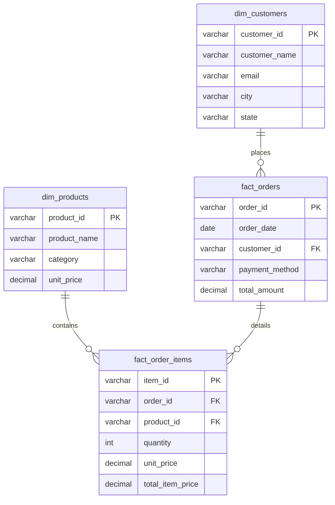

# E-Commerce Database Design & Sales Analytics

**A Dimensional Relational Data Warehouse and Business Intelligence Analytics System built with MySQL, Python, and Power BI.**

---

## 📌 Executive Summary

This project delivers a complete e-commerce data warehousing and business analytics solution evaluating **45,000 orders** and **74,000+ line items**. 

The system takes raw transactional sales data, cleans corrupt and missing records using Python (`pandas`), structures the data into a relational **Star Schema** in MySQL 8.0, enforces 100% referential integrity with primary/foreign key constraints, and provides automated analytical views and Power BI dashboards to track executive business KPIs.

---

## 🏗️ Relational Architecture (Star Schema)



---

## 📁 Repository Structure

```
ecommerce_data_warehouse_analytics/
├── data/
│   ├── raw/
│   │   └── raw_ecommerce_transactions.csv   # Raw e-commerce transactions
│   └── cleaned/
│       ├── dim_customers.csv                # 12,000 unique customers
│       ├── dim_products.csv                 # 25 catalog products
│       ├── fact_orders.csv                  # 45,000 sanitized order headers
│       └── fact_order_items.csv             # 74,000+ line item details
├── ecommerce_data_cleaning_and_modeling.ipynb # Interactive Jupyter Notebook (Cleaning & Modeling)
├── sql/
│   ├── 1_schema_star_model.sql              # MySQL DDL (Star schema, PK/FK, indexes)
│   └── 2_analytical_views.sql               # Executive reporting views (KPIs, categories)
└── powerbi/
    └── DASHBOARD_GUIDE.md                   # Power BI measures & layout guide
```

---

## 🚀 Step-by-Step Workflow

### 1. Data Cleaning in Jupyter Notebook (`ecommerce_data_cleaning_and_modeling.ipynb`)
- Loaded raw orders containing transactions, customer details, and items.
- Identified and removed rows with missing `customer_id`.
- Filtered out negative or zero pricing errors (`total_amount <= 0`).
- Normalized the data into 2 Dimension tables (`dim_customers`, `dim_products`) and 2 Fact tables (`fact_orders`, `fact_order_items`).

### 2. Relational Database Modeling (`sql/1_schema_star_model.sql`)
- Created the `ecommerce_sales_warehouse` database in MySQL.
- Established primary key and foreign key constraints between dimensions and facts, preventing orphan records and guaranteeing 100% referential integrity.
- Created B-Tree indexes on `order_date`, `customer_id`, and `city` to accelerate analytical queries.

### 3. Business Intelligence Views (`sql/2_analytical_views.sql`)
- `vw_daily_sales_performance`: Real-time daily orders, gross revenue, and Average Order Value (AOV).
- `vw_top_selling_products`: Product and category sales volume and revenue contribution.
- `vw_customer_spending_summary`: Customer lifetime spend and purchase frequency.
- `vw_city_level_revenue`: Geographic distribution of sales across major Indian cities.

---

